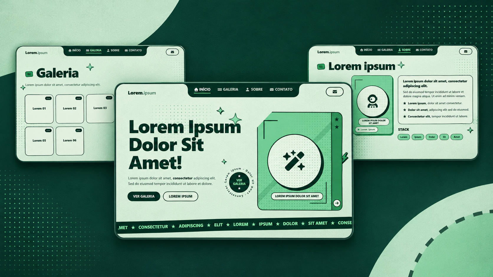

<div align="center">

# Lorem Canvas AnimeJs

### Portfólio interativo em React

[](https://react.dev/)
[](https://www.typescriptlang.org/)
[](https://vite.dev/)
[](https://animejs.com/)



</div>

> Uma experiência de portfólio ilustrativa com navegação horizontal, galeria de projetos e visual editorial em tons verdes.

## Objetivo

Explorar uma interface de portfólio com navegação por seções, transições visuais e interação contextual para apresentar projetos de forma mais dinâmica do que uma landing page convencional. O **Anime.js** orquestra as entradas dos conteúdos por seção, criando uma experiência mais fluida, intuitiva e personalizada sem comprometer a preferência de redução de movimento do sistema.

## Recursos

- Navegação entre início, galeria, sobre e contato.
- Cards de projeto com prévia por hover e modal de detalhes.
- Layout responsivo: modal central no desktop e painel inferior no mobile.
- Entradas sequenciadas com Anime.js, parallax e tokens CSS para uma identidade visual consistente.

## Tecnologias

`React 19` · `TypeScript` · `Vite` · `Anime.js` · `CSS` · `Font Awesome`

## Executar

```bash
npm install
npm run dev
```
